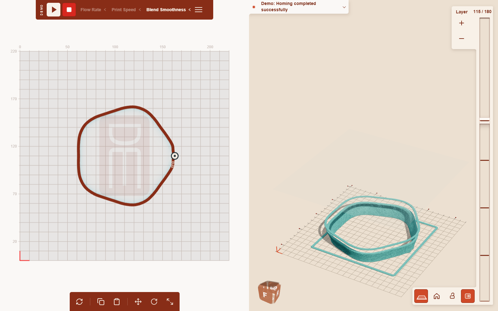

# DIRECTED

This is the initial public source release following private development. Internal work notes and machine-specific deployment helpers are not included.

DIRECTED is a browser-based tool for shaping a 3D print one layer at a time. It combines a 2D path editor, an interactive 3D preview, interpolation between authored layers, and a live connection to a serial printer. The workflow supports exploring a form while keeping individual layers editable until printing locks them.

The purpose is to connect form exploration to the constraints of making it: editable paths and interpolated layers sit alongside nozzle dimensions, layer height, build limits, and printing progress. Treating layers as an evolving form gives this workflow a different emphasis from slicing a completed model: the interface keeps the path and the machine's next layers in view together.

The code includes a client-side demo, G-code export, and a Node.js backend that can stream commands to a connected printer or simulate responses when a connection is unavailable. Printer defaults and homing commands are tailored to the project's clay-printing workflow; they require review for other machines.



Current interface in Demo mode, using an example form created for this documentation.

## Capabilities

- Draw and edit layer paths with Paper.js, and interpolate intermediate layers.
- Inspect the assembled form in Three.js, including layer highlighting and a soundness heatmap.
- Adjust printer dimensions, layer height, and nozzle diameter through the interface.
- Export G-code or send layers to the backend for sequential printing.
- Monitor printer responses and pause, resume, or stop a job.
- Use the splash screen's Demo mode to explore the interface without printer control.

## Run locally

From your downloaded or cloned copy of this snapshot, use a maintained Node.js release and npm. The current CI configuration uses Node 20; rendering tests also run on Node 22. There is no frontend compilation step.

```sh
cd DIRECTED
npm ci
npm start
```

Open the address printed in the terminal, normally `http://localhost:5000`. If that port is busy, the server tries the next 20 ports. `npm run dev` runs the same server with automatic restart through nodemon.

For a hardware-free session, disconnect printers and select **Demo** on the splash screen. The backend's `useMockPrinter` configuration flag is not enforced by its serial connection path: `npm start`, `npm run dev:mock`, and `npm run dev:real` do not provide a hard guarantee against opening a printer port. The latter two scripts currently invoke the same command.

## Printer configuration

`config.js` selects development or production settings through `NODE_ENV`. Development defaults to port 5000; production defaults to port 80. Set `PORT` to override the listener. Only the documented development and production environments are defined.

`PRINTER_PORT` overrides serial port discovery, for example `COM7` on Windows or `/dev/ttyUSB0` on Linux. Without an override, the server prefers the configured port when present, then a recognized USB serial adapter. If it cannot connect, commands use the built-in simulation path.

`frontend/consts.js` supplies print and travel speeds, extrusion parameters, nozzle dimensions, and build height. The server reads several of these values from that file at startup. Runtime printer settings are available through the interface and `/api/printer-config`; those updates live in server memory.

Before connecting hardware, review coordinates, units, extrusion, build limits, and the homing sequence in `server.js`. That sequence includes `M302 S0` to allow cold extrusion. This is a project-specific choice rather than a general printer configuration.

This public snapshot includes the portable Node.js application and its tests. Installation-specific Raspberry Pi networking, hotspot, service, and launcher helpers are omitted. Configure operating-system serial access and any private network separately; the application does not provision them. No Wi-Fi passphrase is distributed with this snapshot.

## Repository layout

```text
frontend/          Browser application, styles, runtime assets and vendor libraries
backend/           Server-side interpolation service
test/              Automated checks and manual diagnostics
docs/screenshots/  Current product screenshots
server.js          Node.js server entry point
config.js          Server environment settings
```

The Node server serves `frontend/` at the site root, so browser URLs and the editing workflow stay the same.

## Architecture

| Area | Main files | Responsibility |
| --- | --- | --- |
| Browser entry and coordination | `frontend/index.html`, `frontend/init.js`, `frontend/app.js` | Interface setup and application events |
| Editing and layers | `frontend/path-editor.js`, `frontend/layer-item.js`, `frontend/utils.js`, `frontend/interpolate.js` | Paths, layer state, interpolation |
| Preview | `frontend/threeD-model.js`, `frontend/heatmap.js` | 3D geometry, rendering, soundness colors |
| Printer interface | `frontend/print-integration.js`, `frontend/printer-log.js`, `frontend/printer-config.js` | Socket.IO connection, feedback, settings |
| Server | `server.js`, `config.js` | Express routes, G-code generation, serial communication, shared print state |
| Server interpolation | `backend/interpolation-service.js` | Batch interpolation of point arrays |
| Vendor libraries | `frontend/lib/` | Bundled Paper.js, Three.js, OrbitControls, Clipper, and Socket.IO client |

The browser sends layer updates over Socket.IO. The server homes the printer, waits for at least five available layers, generates G-code, and processes layers sequentially. A shared server-side job tracks progress; active layers are locked in the client. HTTP endpoints provide health and serial diagnostics, printer settings, and downloadable G-code.

Python is not required for the Node.js application; unused legacy Python scaffolding is omitted. Internal planning records and design experiments are omitted from this snapshot.

## Tests

```sh
npm test
npm run test:rendering
npm run benchmark:rendering
```

`npm test` starts the backend and checks stopping mid-print, preventing subsequent layer events, and starting another session. It expects port 5000 and should run with printers disconnected. `test:rendering` runs eight renderer regression tests using Node's VM modules and the bundled Three.js; it needs no browser or installed dependencies. The benchmark measures renderer work and is diagnostic, not a pass/fail hardware benchmark.

CI currently runs `npm ci` and `npm test`. Automated checks do not establish physical printer safety, cross-platform packaging reliability, or complete browser compatibility.

## Packaging and hosting

`package.json` provides `build:exe`, `build:linux`, `build:linux-arm`, `build:mac`, and `build:mac-arm` scripts for standalone packages using `@yao-pkg/pkg`. These scripts use `npx`, which may download the packaging tool. Packaged serial drivers are extracted beside the executable on first run, so that location needs to be writable. Each target requires separate validation.

Static hosting should publish `frontend/` as its document root. It can serve the demo, but does not run the Express server or provide USB printer access. The original installation-specific Azure publication workflow is omitted; the test CI workflow is retained.

## Security and current limitations

The backend is intended for a trusted local installation. It listens on available network interfaces and has no authentication or per-client authorization. Socket.IO accepts any origin; connected clients can issue printer-control commands, including manual G-code. Do not expose this service to the internet or an untrusted network.

The server currently serves its project directory as static content. Keep credentials, private designs, logs, and machine configuration outside that served directory. The print job is shared across clients, input validation is incomplete, and HTTP traffic is not encrypted by the application. Resolving these constraints requires deliberate changes to deployment and client behavior.

A browser Stop action is a software command, not a certified physical emergency stop. Keep the printer's physical controls accessible and supervise hardware operation.

## Contributing and licensing

Changes should describe the affected editing or printing workflow and the checks performed. For changes to printer behavior, include simulation results and identify any hardware testing that remains.

The package metadata declares MIT. This checkout does not contain a standalone `LICENSE` file; confirm distribution terms with the maintainer. Bundled third-party libraries retain their own notices and licenses.
